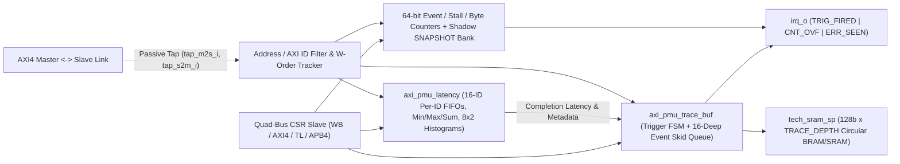
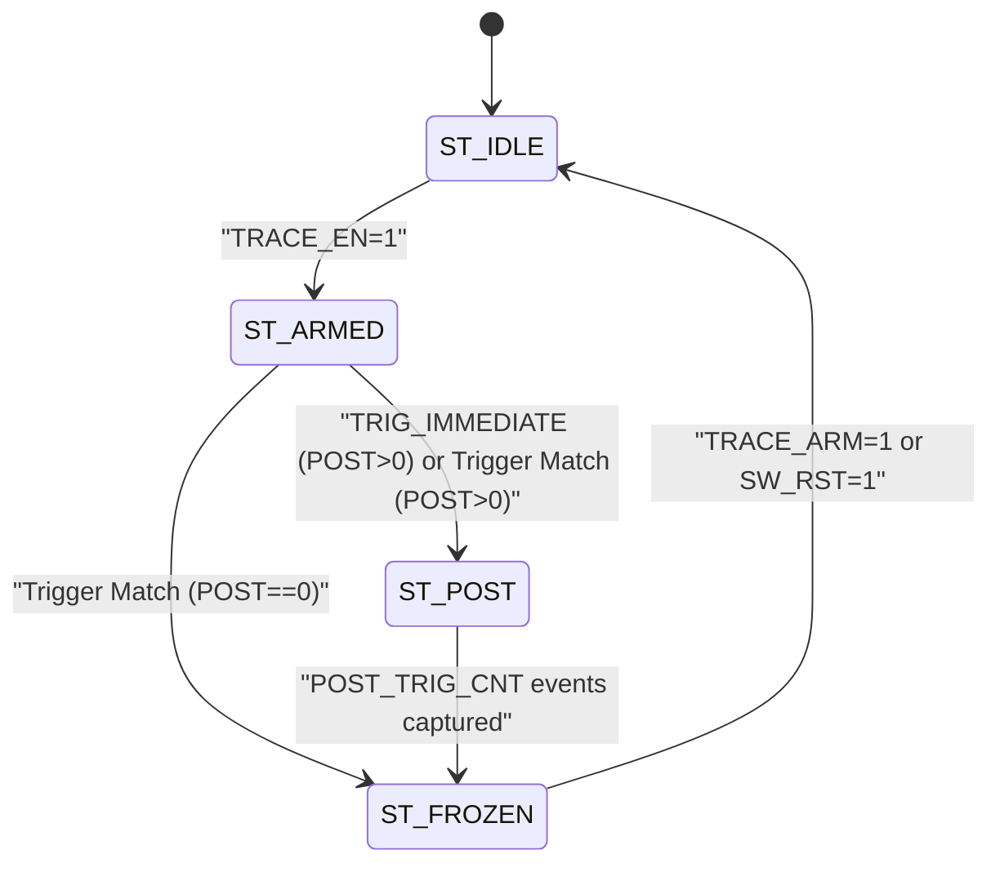

# 51_axi_pmu_trace — AXI4 Performance Monitor Unit (PMU), Latency Histogrammer & Triggered Bus Trace Profiler

`51_axi_pmu_trace` is a clean-room, synthesizable IEEE 1800-2017 SystemVerilog **non-intrusive AXI4 Fabric Performance Monitor Unit (PMU)**, **per-transaction latency histogrammer**, and **ILA-style triggered circular bus trace profiler** with a selectable Quad-Bus CSR control interface (**Wishbone B4**, **AXI4 / AXI4-Lite**, **TileLink TL-UL/TL-UH**, and **AMBA APB4**).

## Key Features

- **Zero-Overhead Passive AXI4 Tap**: Snoops `input axi4_m2s_t tap_m2s_i` and `input axi4_s2m_t tap_s2m_i` with **zero outputs back to the AXI4 fabric** — never inserts combinational delay, registers, or backpressure on the monitored link.
- **64-bit Event, Bandwidth & Stall Counters**:
  - `CYCLE_CNT` (active profiling cycles while `PMU_EN=1`)
  - `RD_TXN_CNT` (AR handshakes), `WR_TXN_CNT` (AW handshakes)
  - `RD_BEAT_CNT` (R handshakes), `WR_BEAT_CNT` (W handshakes), `WR_BYTE_CNT` (synthesizable 4-bit popcount of `wstrb` per W beat)
  - Channel backpressure stall counters: `AR_STALL_CNT`, `AW_STALL_CNT`, `W_STALL_CNT`, `R_STALL_CNT`, `B_STALL_CNT`
  - `RD_ERR_CNT` (`rresp != OKAY` on `RLAST`), `WR_ERR_CNT` (`bresp != OKAY` on `B`)
  - `RD_OUTST_CUR/MAX` and `WR_OUTST_CUR/MAX` outstanding transaction high-water marks
- **Single-Cycle Atomic `SNAPSHOT` Shadow Freeze**: Writing `CTRL.SNAPSHOT` latches all counters, latency stats, and all 16 histogram buckets simultaneously; setting `CTRL.SNAP_VIEW=1` switches CSR reads to the frozen shadow bank while live hardware counters continue running uninterrupted.
- **Programmable Address & AXI ID Filtering**: Maskable `(addr & mask) == (base & mask)` and `(id & id_mask) == (id_val & id_mask)` filtering across all 5 AXI4 channels (`AR`, `R`, `AW`, `W`, `B`).
- **Per-ID Latency Tracker & 8-Bucket Programmable Histograms (`axi_pmu_latency`)**:
  - Tracks `AR -> RLAST` read latency and `AW -> B` write latency across all 16 AXI IDs (`PER_ID_DEPTH = 8` per ID = up to 128 concurrent in-flight transactions).
  - Records `RD_LAT_MIN`, `RD_LAT_MAX`, `RD_LAT_SUM` (64-bit) and `WR_LAT_MIN`, `WR_LAT_MAX`, `WR_LAT_SUM` (64-bit).
  - 7 programmable thresholds `HIST_THRESH[0..6]` partition latency into 8 bins (`B0: <=T0`, `B1: (T0,T1]`, ..., `B7: >T6`) for both reads (`RD_HIST[0..7]`) and writes (`WR_HIST[0..7]`).
- **Programmable Trigger Engine & Circular 128-bit Trace SRAM (`axi_pmu_trace_buf`)**:
  - Captures compact **128-bit (`4 x 32-bit`)** timestamped bus event records into a single-port `tech_sram_sp` (`TRACE_DEPTH = 256` entries = 4 KB BRAM/SRAM).
  - **4 Trigger Modes**: `TRIG_IMMEDIATE` (continuous ring or fixed count), `TRIG_ADDR_MATCH`, `TRIG_ERR` (`SLVERR`/`DECERR`), and `TRIG_LAT_EXCEED` (`lat > TRIG_LAT_THRESH`).
  - **Pre-Trigger + `POST_TRIG_CNT` Post-Trigger Capture**: Buffers pre-trigger history in a circular ring, marks the triggering record (`trig_point=1`) and captures exact `N` post-trigger events before freezing and asserting `irq_o`.

---

## Architecture Block Diagram



### Trigger Engine State Machine



---

## Integration & Parameters (`axi_pmu_trace_top`)

### Parameters

| Parameter | Type | Default | Description |
|---|---|---|---|
| `BUS_TYPE` | `bus_pkg::bus_proto_e` | `BUS_AXI4` | CSR slave protocol: `BUS_WISHBONE` (`0`), `BUS_AXI4` (`1`), `BUS_TILELINK` (`2`), `BUS_APB` (`3`) |
| `TRACE_DEPTH` | `int unsigned` | `256` | Circular trace SRAM depth in 128-bit entries (must be power of 2; `256` = 4 KB) |
| `PER_ID_DEPTH` | `int unsigned` | `8` | In-flight transactions tracked per AXI ID (`16 * PER_ID_DEPTH` total capacity) |

### Ports

| Port | Direction | Width / Type | Description |
|---|---|---|---|
| `clk_i` | `input` | `logic` | System clock (must match tapped AXI4 link clock) |
| `rst_ni` | `input` | `logic` | Active-low reset (async-assert; trace SRAM itself has no async reset) |
| `wb_i` / `wb_o` | `in/out` | `wb_m2s_t` / `wb_s2m_t` | Wishbone B4 CSR port (used when `BUS_TYPE == BUS_WISHBONE`) |
| `axi_i` / `axi_o` | `in/out` | `axi4_m2s_t` / `axi4_s2m_t` | AXI4 / AXI4-Lite CSR port (used when `BUS_TYPE == BUS_AXI4`) |
| `tl_i` / `tl_o` | `in/out` | `tl_m2s_t` / `tl_s2m_t` | TileLink TL-UL CSR port (used when `BUS_TYPE == BUS_TILELINK`) |
| `apb_i` / `apb_o` | `in/out` | `apb_m2s_t` / `apb_s2m_t` | AMBA APB4 CSR port (used when `BUS_TYPE == BUS_APB`) |
| `tap_m2s_i` | `input` | `axi4_m2s_t` | Passive AXI4 master-to-slave tap (wire in parallel to any AXI4 link) |
| `tap_s2m_i` | `input` | `axi4_s2m_t` | Passive AXI4 slave-to-master tap (wire in parallel to any AXI4 link) |
| `irq_o` | `output` | `logic` | Level-high combined interrupt (`|(IRQ_STAT & IRQ_EN)`) |

### Parallel Tap vs Inline Passthrough Wiring

Because `tap_m2s_i` and `tap_s2m_i` are pure inputs, `axi_pmu_trace_top` wires directly in parallel to any existing AXI4 link without altering timing or handshakes:

```systemverilog
// Standalone parallel passive tap on an existing DMA <-> Interconnect AXI4 link:
axi_pmu_trace_top #(.BUS_TYPE(bus_pkg::BUS_APB)) u_dma_pmu (
  .clk_i     (clk),
  .rst_ni    (rst_n),
  .wb_i      ('0), .wb_o  (),
  .axi_i     ('0), .axi_o (),
  .tl_i      ('0), .tl_o  (),
  .apb_i     (pmu_apb_m2s),
  .apb_o     (pmu_apb_s2m),
  .tap_m2s_i (dma_m_axi_m2s),
  .tap_s2m_i (dma_m_axi_s2m),
  .irq_o     (pmu_irq)
);
```

For inline interconnect insertion, simply wire `m_axi_o = s_axi_i; s_axi_o = m_axi_i;` at the harness boundary and tap `tap_m2s_i = s_axi_i; tap_s2m_i = m_axi_i;`.

---

## 128-Bit Trace Record Format

Each captured event occupies 128 bits (`4 x 32-bit` words) in `tech_sram_sp`, read back via `PMU_TRACE_RD_IDX` -> `PMU_TRACE_WORD0..3`:

| Word | Bits | Field | Description |
|---|---|---|---|
| `WORD0` | `[31:0]` | `timestamp` | Lower 32 bits of `CYCLE_CNT` at handshake cycle |
| `WORD1` | `[31:0]` | `addr` | Transaction byte address (`araddr` / `awaddr`, preserved through `R_DONE`/`B_DONE`) |
| `WORD2` | `[3:0]` | `evt_type` | `0=AR`, `1=AW`, `2=R_DONE`, `3=B_DONE`, `4=R_ERR`, `5=B_ERR` |
| `WORD2` | `[7:4]` | `axi_id` | 4-bit AXI transaction ID (`arid`/`awid`/`rid`/`bid`) |
| `WORD2` | `[15:8]` | `len` | AXI burst length (`beats - 1`) |
| `WORD2` | `[18:16]` | `size` | AXI transfer size (`2^size` bytes/beat) |
| `WORD2` | `[20:19]` | `burst` | AXI burst type (`0=FIXED`, `1=INCR`, `2=WRAP`) |
| `WORD2` | `[22:21]` | `resp` | AXI response (`rresp`/`bresp`; `0` on `AR`/`AW`) |
| `WORD2` | `[26:23]` | `qos` | AXI QoS (`arqos`/`awqos`) |
| `WORD2` | `[29:27]` | `prot` | AXI protection (`arprot`/`awprot`) |
| `WORD2` | `[30]` | `is_write` | `1` for write events (`AW`, `B_DONE`, `B_ERR`), `0` for reads |
| `WORD2` | `[31]` | `trig_point` | `1` on the exact event that fired the trigger engine |
| `WORD3` | `[31:0]` | `data_or_lat` | Transaction latency in cycles (`AR->RLAST` or `AW->B`) for completions; `0` for `AR`/`AW` |

---

## CSR Register Map

All registers are 32-bit word-aligned (`0x000..0x13C`). Counters, error counts, `OUTST_STATUS` max watermarks, latency stats, and histogram bins are automatically muxed between live and frozen `SNAPSHOT` shadow banks via `CTRL.SNAP_VIEW`.

| Offset | Name | Access | Reset | Bitfields / Description |
|---|---|---|---|---|
| `0x000` | `CAP_ID` | RO | `0x504D5531` | `"PMU1"` Capability ID |
| `0x004` | `CTRL` | RW/W1P | `0x00000000` | `[0] PMU_EN`, `[1] TRACE_EN`, `[2] CLR_COUNTERS` (W1P), `[3] TRACE_ARM` (W1P), `[4] SNAPSHOT` (W1P), `[5] SNAP_VIEW`, `[6] SW_RST` (W1P), `[7] OVF_32B_MODE` |
| `0x008` | `STATUS` | RO | `0x00000000` | `[0] ACTIVE`, `[1] TRACE_ARMED`, `[2] TRACE_POST`, `[3] TRACE_FROZEN`, `[4] TRIG_FIRED`, `[5] TRACE_WRAP`, `[6] TRACE_BUSY`, `[7] SNAP_VALID`, `[15:8] RD_OUTST_CUR`, `[23:16] WR_OUTST_CUR`, `[24] TRACE_Q_OVF` |
| `0x00C` | `IRQ_EN` | RW | `0x00000000` | `[0] TRIG_FIRED`, `[1] CNT_OVF`, `[2] ERR_SEEN` |
| `0x010` | `IRQ_STAT` | W1C | `0x00000000` | `[0] TRIG_FIRED`, `[1] CNT_OVF`, `[2] ERR_SEEN` |
| `0x014` | `FILT_CTRL` | RW | `0x00000000` | `[0] ADDR_EN`, `[1] ID_EN`, `[11:8] ID_VAL`, `[19:16] ID_MASK` (reset `4'hF`) |
| `0x018` | `FILT_ADDR_BASE` | RW | `0x00000000` | Address filter comparison base |
| `0x01C` | `FILT_ADDR_MASK` | RW | `0x00000000` | Address filter bitmask (`1` = bit compared) |
| `0x020` | `TRIG_CTRL` | RW | `0x00000F00` | `[1:0] TRIG_MODE` (`0=IMM, 1=ADDR, 2=ERR, 3=LAT`), `[2] TRACE_FILT_ONLY`, `[11:8] EVT_MASK` (`[8]=AR,[9]=AW,[10]=R,[11]=B`), `[31:16] POST_TRIG_CNT` |
| `0x024` | `TRIG_LAT_THRESH` | RW | `0x00000040` | Latency threshold (cycles) for `TRIG_LAT_EXCEED` (`lat > thresh`) |
| `0x028` | `TRACE_WPTR` | RO | `0x00000000` | `[15:0] WPTR` (next write index), `[31:16] TRIG_PTR` (trigger entry index) |
| `0x02C` | `TRACE_CNT` | RO | `{TRACE_DEPTH, 0}` | `[15:0] VALID_CNT` (`0..TRACE_DEPTH`), `[31:16] TRACE_DEPTH` |
| `0x030` | `TRACE_RD_IDX` | RW | `0x00000000` | Writing index triggers single-port SRAM read into `TRACE_WORD0..3` |
| `0x034..0x040` | `TRACE_WORD0..3` | RO | `0x00000000` | 128-bit readback window (`WORD0`=ts, `WORD1`=addr, `WORD2`=meta, `WORD3`=data_or_lat) |
| `0x050..0x054` | `CYCLE_CNT_LO/HI` | RO | `0` | 64-bit profiling cycle counter |
| `0x058..0x05C` | `RD_TXN_CNT_LO/HI` | RO | `0` | 64-bit AR handshake counter |
| `0x060..0x064` | `WR_TXN_CNT_LO/HI` | RO | `0` | 64-bit AW handshake counter |
| `0x068..0x06C` | `RD_BEAT_CNT_LO/HI` | RO | `0` | 64-bit R beat counter |
| `0x070..0x074` | `WR_BEAT_CNT_LO/HI` | RO | `0` | 64-bit W beat counter |
| `0x078..0x07C` | `WR_BYTE_CNT_LO/HI` | RO | `0` | 64-bit W active byte counter (`popcount(wstrb)`) |
| `0x080..0x0A4` | `*_STALL_CNT_LO/HI` | RO | `0` | 64-bit stall cycle counters (`0x080=AR`, `0x088=AW`, `0x090=W`, `0x098=R`, `0x0A0=B`) |
| `0x0A8` | `RD_ERR_CNT` | RO | `0` | 32-bit read error count (`rresp != OKAY` on `RLAST`) |
| `0x0AC` | `WR_ERR_CNT` | RO | `0` | 32-bit write error count (`bresp != OKAY` on `B`) |
| `0x0B0` | `OUTST_STATUS` | RO | `0` | `[7:0] RD_CUR`, `[15:8] RD_MAX`, `[23:16] WR_CUR`, `[31:24] WR_MAX` |
| `0x0C0..0x0CC` | `RD_LAT_MIN/MAX/SUM` | RO | `MIN=0xFFFFFFFF` | Read latency min (32b), max (32b), sum (64b `LO/HI`) |
| `0x0D0..0x0DC` | `WR_LAT_MIN/MAX/SUM` | RO | `MIN=0xFFFFFFFF` | Write latency min (32b), max (32b), sum (64b `LO/HI`) |
| `0x0E0..0x0F8` | `HIST_THRESH[0..6]` | RW | `2,4,8,16,32,64,128` | 7 histogram bin boundary thresholds (`0x0E0 + 4*i`) |
| `0x100..0x11C` | `RD_HIST[0..7]` | RO | `0` | 8 read latency histogram buckets (`0x100 + 4*i`) |
| `0x120..0x13C` | `WR_HIST[0..7]` | RO | `0` | 8 write latency histogram buckets (`0x120 + 4*i`) |

---

## Software Support (`sw/`)

- [axi_pmu_regs.h](../sw/axi_pmu_regs.h): Complete C99 CSR definitions, bitfield macros, `axi_pmu_trace_record_t` unpacker, and 32/64-bit MMIO helpers.
- [axi_pmu_profile_example.c](../sw/axi_pmu_profile_example.c): Ready-to-use bare-metal profiling routines:
  - `pmu_start_profile(...)` — configures address/ID filter and 7 histogram thresholds and starts counters.
  - `pmu_read_report(...)` — freezes an atomic `SNAPSHOT` (`SNAP_VIEW=1`), reads all 64-bit counters & 16 histogram bins, restores live view, and calculates MB/s bandwidth, bus utilization %, stall %, and average latency.
  - `pmu_arm_latency_spike_trace(...)` — arms `TRIG_LAT_EXCEED` with pre-trigger circular buffering and `POST_TRIG_CNT` capture.
  - `pmu_dump_trace_sram(...)` — reads back all valid 128-bit records in chronological order (`oldest -> newest`) and flags the trigger point.

---

## Synthesis & Verification Notes

- **Yosys / FPGA BRAM / ASIC SRAM**: Uses `common/rtl/tech/tech_sram_sp.sv` (`128b x 256`) with clock-only writes and zero async reset on memory arrays. Per-ID latency tables and the trace event skid queue keep payload arrays free of async-reset `for` loops. Verified clean via `python3 scripts/check_yosys_compat.py`.
- **Verification (`tb/tb_axi_pmu_trace.sv`)**: Self-checking Verilator testbench with an independent cycle-accurate golden AXI4 scoreboard covering:
  1. Exact bandwidth, beat, `wstrb` byte popcount, 5-channel stalls, `SLVERR`/`DECERR` errors, outstanding max watermarks, and atomic `SNAPSHOT` shadow freeze.
  2. Combined address + AXI ID filtering across mixed matching/non-matching traffic.
  3. Latency min/max/sum and all 8 read + 8 write histogram buckets.
  4. All 4 trace trigger modes (`TRIG_IMMEDIATE` >256-entry wraparound, `TRIG_ERR`, `TRIG_LAT_EXCEED`, `TRIG_ADDR_MATCH`) with pre-trigger + `POST_TRIG_CNT` post-trigger capture and bit-exact 128-bit SRAM readback.
  5. Quad-bus CSR cross-check (`WB`, `AXI4`, `TL`, `APB4`) and randomized burst/stall/error stress (`+seed`).
